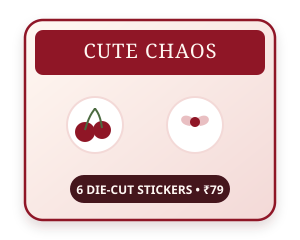

# BAGÉRA — "Carry Your Little World."
### Web Technology CCE-5 Evaluation Project

[](https://developer.mozilla.org/en-US/docs/Web/Guide/HTML/HTML5)
[](https://developer.mozilla.org/en-US/docs/Web/CSS)
[](https://developer.mozilla.org/en-US/docs/Web/JavaScript)
[](https://marketplace.visualstudio.com/items?itemName=ritwickdey.LiveServer)

> **GitHub Repository:** [https://github.com/Prajwalkumar2005/webtech-cce-5-](https://github.com/Prajwalkumar2005/webtech-cce-5-)  
> **Brand Name:** BAGÉRA  
> **Tagline:** *"Carry Your Little World."*  
> **Aesthetic:** Independent Fashion Boutique meets Pinterest-inspired Editorial Chic.  

---

## 1. Project Overview

**BAGÉRA** is an art-directed, fashion-forward handbag shopping website built exclusively with **semantic HTML5, modern CSS3, and modular Vanilla JavaScript**. Designed as a college **Web Technology CCE-5** project, BAGÉRA steers completely clear of generic, repetitive AI-generated e-commerce templates. Instead, it embodies the visual storytelling, editorial typography, and playful warmth of a high-end independent boutique while offering realistic, ultra-affordable accessories priced strictly between **₹50 and ₹199**.

A major brand differentiator is **The Sticker Club** and the **Interactive Bundle & Customise Studio** ("Your bag. Your rules."), allowing customers to pair handbag silhouettes with die-cut aesthetic stickers inspired by Pinterest laptop and cafe journal cultures.

---

## 2. Project Objectives

1. **Pure Standards Compliance:** Adhere strictly to vanilla web technologies without any third-party frameworks (no React, Next.js, Vue, Angular, Tailwind, or Bootstrap).
2. **Award-Winning Visual Design:** Deliver a sophisticated cherry-red (`#8F1728`) and warm-ivory (`#FFF8F2`) palette featuring Google Fonts (*DM Serif Display* & *DM Sans*), asymmetric layouts, floating SVG stickers, and refined drop shadows.
3. **End-to-End E-Commerce Interactions:** Implement a fully working shopping cart, live subtotal/total calculations, free shipping progress bar, wishlist toggling, quick view modals, live catalog search, dynamic category filtering, price slider, and an interactive checkout demonstration with order receipts.
4. **State Persistence:** Ensure complete persistence of shopping bag items and user wishlist favorites across page reloads using browser `localStorage`.
5. **Universal Responsiveness:** Deliver an exceptional, fluid experience across desktop monitors, laptops, tablets, and mobile devices.

---

## 3. Key Features

- **Cherry-Red Announcement Bar:** Slim, responsive top bar announcing new studio drops and free shipping.
- **Responsive Sticky Header & Navigation:** Elegant logo, centered navigation links, quick search trigger, interactive wishlist drawer trigger with live item count, shopping cart drawer trigger with live item count, and mobile hamburger drawer.
- **Editorial Hero Section:** Asymmetric split layout with bold editorial serif typography, dual call-to-actions, and an art-directed handbag composition surrounded by floating interactive SVG stickers (*Good Style Good Mood badge, glossy cherries, blush bow, handwritten "made for you" note, and sparkle disco stars*).
- **Interactive Category Filter Grid:** 6 curated silhouette tiles (*Tote Bags, Shoulder Bags, Sling Bags, Mini Bags, Everyday Bags, and Cute Accessories*) with hover zoom animations and URL parameter synchronization to the Shop page.
- **Realistic Featured Product Catalog:** Handbags priced between ₹99 and ₹199 with realistic details, badges (*BESTSELLER, NEW, STUDIO PICK*), wishlist heart toggling, and Quick View triggers.
- **The Sticker Club:** A Pinterest-inspired section featuring 3 curated sticker packs (*Cute Chaos, Main Character Energy, Little Happy Things*) and an interactive gallery of individual die-cut vinyl stickers (₹50–₹55).
- **Interactive Bundle & Customise Studio:** Live interactive canvas ("Your bag. Your rules.") where customers select a handbag and a sticker pack, dynamically preview the combination on the bag, calculate real-time savings (₹29 discount), and add the combined custom bundle to their shopping cart.
- **New Arrivals Horizontal Showcase:** Smooth touch-friendly horizontal slider showcasing weekly studio drops.
- **Brand Story Section:** Editorial two-column storytelling covering our craft, vegan materials, and philosophy.
- **Interactive Newsletter:** Frontend email regex validation with animated inline success messages and toast notifications.
- **Full Slide-In Cart & Wishlist Drawers:** Smooth sliding drawers with quantity increment/decrement, live subtotal/total calculation, free shipping threshold progress meter, and empty state illustrations.
- **Quick View Modal:** In-depth product modal with high-resolution imagery, specifications, dimensions, materials, and Add to Bag buttons.
- **Global Instant Live Search:** Real-time search modal that matches product names, categories, and descriptions as the user types.
- **Checkout Demonstration:** Complete shipping details form (*Name, Email, Phone, Address, PIN Code*), field validation, order review, and an instant confirmation screen with a generated Order ID.

---

## 4. Technologies Used

- **HTML5:** Semantic tags (`<header>`, `<nav>`, `<main>`, `<section>`, `<article>`, `<aside>`, `<footer>`) ensuring accessibility and SEO structure.
- **CSS3:** Custom properties (CSS variables), Flexbox, CSS Grid, `@keyframes` animations, backdrop blur filters, custom scrollbars, and media queries.
- **Vanilla JavaScript (ES6+):** Modular, decoupled scripts handling DOM manipulation, event delegation, array filtering, state management, and `localStorage` persistence.
- **Typography (Google Fonts):**
  - Major Headings: *DM Serif Display*
  - Body & UI: *DM Sans*
  - Handwritten Accents: *Caveat*
- **Assets:** High-resolution fashion imagery with custom SVG die-cut stickers and guaranteed local SVG fallbacks to prevent broken image icons under any network condition.

---

## 5. Project Folder Structure

```
webtech-cce-5/
├── index.html                  # Homepage (All 11 Core Sections & Modals)
├── shop.html                   # Dedicated Catalog (Filter, Sort, Search, Slider)
├── about.html                  # Brand Story, Studio Values, FAQ, Craftsmanship
├── css/
│   └── style.css               # Complete Design System & Responsive Stylesheet
├── js/
│   ├── products.js             # Product & Sticker Club Data Catalog (Array of Objects)
│   ├── cart.js                 # Cart State, Wishlist, LocalStorage, Drawers & Toasts
│   ├── main.js                 # Homepage Controllers, Quick View, Bundle Studio, Checkout
│   └── shop.js                 # Shop Page Filtering, Price Slider, Sorting, URL Sync
├── assets/
│   ├── images/                 # Custom SVG Handbags, Sticker Packs, Doodles & Fallbacks
│   │   ├── badge-good-style.svg
│   │   ├── bag-blush-shoulder.svg
│   │   ├── bag-canvas-tote.svg
│   │   ├── bag-cherry-mini.svg
│   │   ├── bag-classic-daily.svg
│   │   ├── bag-pocket-cutie.svg
│   │   ├── bag-sling-little.svg
│   │   ├── bag-sunday-tote.svg
│   │   ├── bag-weekend.svg
│   │   ├── category-accessories.svg
│   │   ├── category-everyday.svg
│   │   ├── category-mini.svg
│   │   ├── category-shoulder.svg
│   │   ├── category-sling.svg
│   │   ├── category-tote.svg
│   │   ├── hero-handbag-composition.svg
│   │   ├── note-made-for-you.svg
│   │   ├── pack-cute-chaos.svg
│   │   ├── pack-happy-things.svg
│   │   ├── pack-main-character.svg
│   │   ├── sticker-bow.svg
│   │   ├── sticker-cherries.svg
│   │   ├── sticker-coffee.svg
│   │   ├── sticker-flower.svg
│   │   ├── sticker-heart.svg
│   │   └── sticker-star.svg
│   └── icons/                  # SVG Icons for UI Elements
└── README.md                   # Comprehensive Project Documentation
```

---

## 6. How to Run the Project

This project is built purely with client-side technologies and requires zero build steps, npm installations, or compilation.

### Option A: Using VS Code Live Server (Recommended)
1. Open Visual Studio Code.
2. Clone or open the project folder `webtech-cce-5`.
3. Install the **Live Server** extension (by Ritwick Dey) if not already installed.
4. Right-click on `index.html` and select **"Open with Live Server"** (or click "Go Live" in the bottom status bar).
5. The website will open in your default browser at `http://127.0.0.1:5500/index.html`.

### Option B: Using Python Local Server
If Python is installed on your system, execute the following command in the project root directory:
```bash
# Python 3
python -m http.server 8000
```
Open your browser and navigate to: `http://localhost:8000`

### Option C: Direct File Opening
You can also double-click `index.html` to open it directly in Google Chrome, Microsoft Edge, Mozilla Firefox, or Safari.

---

## 7. How JavaScript Functionalities Work

### A. Data Catalog (`products.js`)
All catalog data is stored in the `BAGERA_PRODUCTS` and `BAGERA_STICKERS` arrays of objects. Each item contains:
- `id`: Unique identifier (e.g., `bag-1`, `pack-1`, `stk-1`).
- `name`: Product title (e.g., *"Cherry Pop Mini Bag"*).
- `price`: Strict numeric INR price within ₹50 to ₹199.
- `category`: Category group (*Mini Bags, Tote Bags, Shoulder Bags, Sling Bags, Everyday Bags, Cute Accessories, Sticker Pack, Sticker*).
- `image`: High-res fashion photograph URL.
- `fallbackImage`: Guaranteed local vector SVG to ensure 0% broken image probability.
- `badge`: Display tag (*BESTSELLER, NEW, STUDIO PICK*).
- `details`: Array of bullet points for Quick View modal rendering.

### B. Cart & Wishlist Engine (`cart.js`)
- **State Management:** Cart items are stored in `bageraCart` and wishlist items in `bageraWishlist`.
- **`localStorage` Synchronization:** Every mutation triggers `saveCart()` or `saveWishlist()`, serializing state to `JSON` strings in the browser.
- **Dynamic Calculation:** `getCartCalculations()` calculates item counts, subtotal, promotional discounts, and dynamically determines if the customer qualifies for Free Shipping (threshold: ₹299).
- **Drawers:** Slide-in animations are triggered using class toggling (`.open`, `.visible`), locking background scrolling with `document.body.classList.add("modal-open")`.
- **Toast Notifications:** `showToast(message, icon)` creates temporary, animated floating pills for instant user feedback.

### C. Homepage & Studio Controllers (`main.js`)
- **Bundle Customizer:** An interactive two-step selector updates DOM element sources on the live handbag preview and computes promotional bundle savings.
- **Quick View Modal:** Injects dynamic content into `#quick-view-modal-body` based on product ID lookups.
- **Global Search:** Watches the search input, performing real-time regex/case-insensitive substring filtering across all items and displaying instant search result rows.
- **Checkout Simulation:** Validates customer inputs (*Full Name, Email format, Phone, Address, PIN code*), calculates the final bill, and renders an order receipt screen with a randomly generated Order ID (e.g., `#BAG-842915`).

### D. Shop Page Controllers (`shop.js`)
- **Multi-faceted Filtering:** Combines category checkboxes, price range sliders, and "New Drops Only" filters in a unified pipeline.
- **Sorting Logic:** Implements JavaScript `Array.prototype.sort()` to arrange products by price (low to high, high to low) and release recency.
- **Deep Linking:** Parses `window.location.search` (`URLSearchParams`) so clicking a category on the homepage seamlessly opens `shop.html` with that category pre-filtered.

---

## 8. Design System & Aesthetics

| Element | Specification | Hex / Value |
| :--- | :--- | :--- |
| **Primary Accent** | Cherry Red | `#8F1728` |
| **Deep Contrast** | Deep Burgundy | `#44121D` |
| **Warm Canvas** | Warm Ivory | `#FFF8F2` |
| **Soft Tint** | Soft Blush | `#F3D9D7` |
| **Muted Tone** | Muted Pink | `#E9BFC2` |
| **Typography Dark** | Deep Charcoal Rose | `#25191B` |
| **Editorial Heading Font** | DM Serif Display | Google Fonts (Serif) |
| **UI & Body Font** | DM Sans | Google Fonts (Sans-Serif) |
| **Handwritten Accents** | Caveat | Google Fonts (Cursive) |

---

## 9. Screenshots Section

*(Placeholders for academic submission reports and README previews)*

| Homepage Hero Section | Category & Product Grid |
| :---: | :---: |
|  |  |
| **The Sticker Club & Bundle Customizer** | **Cart Drawer & Checkout Simulation** |
|  |  |

---

## 10. Future Scope

1. **Backend & Database Integration:** Connect Node.js/Express with MongoDB or PostgreSQL for persistent user accounts and real inventory management.
2. **Payment Gateway Integration:** Integrate Razorpay or Stripe India sandbox for live test UPI/Card transactions.
3. **Interactive 3D Bag Customizer:** Upgrade the 2D SVG Bundle Customizer to a 3D WebGL/Three.js model allowing users to drag and drop stickers anywhere on a 3D rotating handbag.
4. **Customer Reviews & UGC Feed:** Allow customers to upload photos of their customized bags directly into an aesthetic community grid.

---

## 11. Author & Repository Information

- **Student / Author:** Prajwalkumar
- **Course:** Web Technology (CCE-5)
- **Academic Evaluation:** E-Commerce Frontend Demonstration
- **GitHub Repository:** [https://github.com/Prajwalkumar2005/webtech-cce-5-](https://github.com/Prajwalkumar2005/webtech-cce-5-)
- **License:** MIT License (Open-Source for Educational Demonstration)

---
*BAGÉRA — Carry Your Little World. Handcrafted with HTML5, CSS3, and Vanilla JavaScript.*
